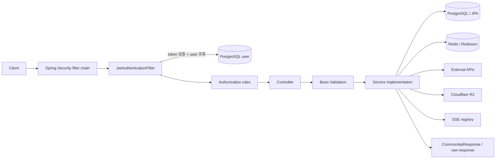
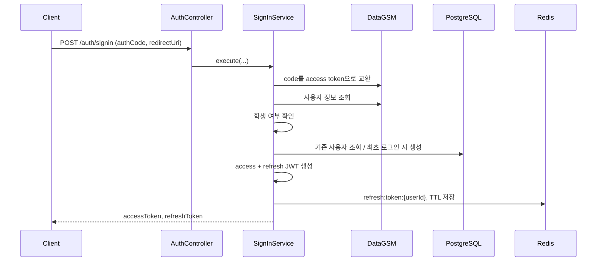

# Flooding Server V2 코드 분석

> `team-incube/Flooding-Server-V2`의 실제 Kotlin 서버가 요청을 어떻게 받아 처리하는지 코드 기준으로 추적한 문서입니다.

## 분석 기준

- 원본 저장소: [team-incube/Flooding-Server-V2](https://github.com/team-incube/Flooding-Server-V2)
- 대상 브랜치: `master`
- 기준 커밋: [`53a3c80e4e0c0d36e4cf84e97047fd5676628376`](https://github.com/team-incube/Flooding-Server-V2/tree/53a3c80e4e0c0d36e4cf84e97047fd5676628376)
- 분석일: 2026-10-03
- 범위: `src/main/kotlin`, `src/main/resources`, 관련 테스트 및 Gradle 설정

문서의 내용은 API 명세만 옮긴 것이 아니라 Controller → Service → Repository/Adapter → DB·Redis·외부 API 순서로 실제 구현을 따라가며 확인했습니다.

## 한눈에 보는 서버

Flooding Server V2는 학교 생활 기능을 한 서버에 묶은 Spring Boot 기반 REST API입니다. PostgreSQL에는 지속 데이터, Redis에는 토큰·당일 신청 상태·캐시를 저장하고, 실시간 갱신에는 SSE를 사용합니다.

| 구분 | 구현 |
| --- | --- |
| 언어 / 런타임 | Kotlin 2.2.21, Java toolchain 24 |
| 프레임워크 | Spring Boot 4.0.2, Spring MVC, Spring Security 7 |
| 영속 저장소 | PostgreSQL + Spring Data JPA |
| 단기 상태 / 락 | Redis + Redisson |
| 인증 | DataGSM OAuth → 자체 JWT access/refresh token |
| 외부 연동 | DataGSM, NEIS, YouTube Data API, AI 챗봇·추천 서버, Cloudflare R2 |
| 실시간 처리 | Spring `SseEmitter`, 비동기 전송, 30초 heartbeat |
| API 문서 | springdoc-openapi / Swagger UI |
| 규모 | main Kotlin 278개, test Kotlin 38개, Controller 15개, HTTP endpoint 59개 |

## 전체 요청 흐름



1. 공개 경로를 제외한 요청은 [`JwtAuthenticationFilter`](https://github.com/team-incube/Flooding-Server-V2/blob/53a3c80e4e0c0d36e4cf84e97047fd5676628376/src/main/kotlin/team/incube/flooding/global/security/filter/JwtAuthenticationFilter.kt)를 거칩니다.
2. Bearer JWT가 유효하면 토큰의 `subject`에서 사용자 ID를 읽고 DB에서 최신 사용자·권한을 조회해 `SecurityContext`를 구성합니다.
3. [`SecurityConfig`](https://github.com/team-incube/Flooding-Server-V2/blob/53a3c80e4e0c0d36e4cf84e97047fd5676628376/src/main/kotlin/team/incube/flooding/global/security/config/SecurityConfig.kt)의 URL/HTTP method 규칙으로 1차 인가합니다.
4. Controller는 입력을 DTO로 받고 Bean Validation을 적용한 뒤 기능별 Service interface를 호출합니다.
5. Service 구현이 트랜잭션, 소유권·상태 검증, JPA/Redis/외부 API 호출을 담당합니다. 일부 권한은 URL 규칙이 아니라 이 계층에서 추가 확인합니다.
6. 일반 JSON 응답은 대부분 `CommonApiResponse`로 감싸지만 로그인·재발급, 일부 기상음악 응답, SSE, 엑셀 다운로드는 각 형식 그대로 반환합니다.

## 도메인 구성

| 도메인 | 핵심 기능 | 주 저장소 / 연동 |
| --- | --- | --- |
| `auth` | OAuth 로그인, 최초 사용자 생성, JWT 발급·재발급 | DataGSM OAuth, PostgreSQL, Redis |
| `user` | 내 정보, 학생 검색, 권한 변경, 프로필 이미지 | PostgreSQL, R2 |
| `club` | 개설·승인, 신청 폼, 멤버 관리, 선착순 신청, 엑셀 | PostgreSQL, Redisson, DataGSM, R2 |
| `dormitory.study` | 자습 신청·취소·출석·금지, 실시간 출석 | Redis, PostgreSQL, Redisson, SSE |
| `dormitory.music` | YouTube 기반 기상음악, 좋아요, 실시간 갱신 | PostgreSQL, YouTube, SSE |
| `dormitory.massage` | 시간·정원 기반 선착순 대기열 | Redis, Redisson |
| `dormitory.penalty` | 벌점 조회·설정 및 이력 | PostgreSQL |
| `dormitory.cleaningzone` | 청소 구역 생성·조회·인원 교체 배정 | PostgreSQL |
| `homebase` | 날짜·교시 단위 공간 예약과 중복 검사 | PostgreSQL |
| `neis` | 급식·시간표 조회 | DataGSM NEIS API |
| `ai` | 인증 전달형 챗봇, 최근 신청곡 기반 추천 | 별도 AI 서버, Resilience4j |

## 대표 흐름 요약

### 1. 로그인과 토큰 재발급



재발급은 JWT 서명·만료 검증 후 Redis 값과 문자열까지 일치하는지 확인하며, 성공하면 access/refresh token을 모두 회전합니다. 불일치 시 저장된 refresh token을 삭제합니다.

### 2. 자습 신청의 동시성 제어

자습 신청은 시간·금지 상태를 먼저 확인하고 Redisson 분산 락을 얻은 뒤 Redis의 신청 상태와 인원 수를 갱신합니다. 정원 초과 시 증가시킨 카운트를 되돌리고, 신청 상태·신청자 목록에는 다음 오전 6시까지 TTL을 겁니다. 별도 스케줄러도 매일 오전 6시에 관련 키를 정리합니다.

```text
현재 사용자 → 신청 시간 확인 → 금지 여부 확인 → 분산 락 획득
→ 중복/당일 취소 확인 → 인원 +1 → 정원 확인
→ APPROVED 상태 + 신청자 목록 저장 → 락 해제
```

### 3. 기상음악과 SSE

신청 URL에서 YouTube video ID를 추출해 Data API로 제목·채널·길이·썸네일을 얻고 DB에 저장합니다. 트랜잭션 커밋 후에만 `music-applied`, `music-cancelled`, `music-like-updated` 이벤트를 방송하므로 롤백된 데이터를 클라이언트에 먼저 알리지 않습니다. 구독 연결 시 `connect`와 당일 전체 목록 `init`을 전송하며 30초마다 heartbeat를 보냅니다.

### 4. 동아리 수명주기

동아리 개설 신청은 `PENDING`으로 저장됩니다. 승인 시 상태를 `APPROVED`/`MAINTAIN`으로 바꾸고, 트랜잭션 커밋 뒤 비동기 이벤트로 리더를 참가자로 등록하고 DataGSM에도 동아리를 생성합니다. 전공 동아리는 동적 폼·답변으로 신청하고 리더가 승인하며, 자율 동아리는 동아리별 분산 락 안에서 정원을 확인해 바로 참가자를 저장합니다.

### 5. AI 프록시

챗봇 요청은 사용자의 `Authorization` 헤더를 별도 AI 서버에 그대로 전달합니다. 음악 추천은 현재 사용자의 최근 기상음악 최대 5개를 읽어 `(title, artist)` 목록으로 변환해 추천 서버로 전송합니다. 연결 실패만 재시도하고, 누적 실패·지연이 임계치를 넘으면 circuit breaker가 열려 `503`으로 빠르게 실패합니다.

## 구현을 읽으며 확인한 특징

- **DB를 통한 권한 최신성:** JWT에는 사용자 ID만 넣고 매 요청 DB에서 사용자를 다시 읽으므로 역할 변경이 다음 요청부터 반영됩니다. 대신 인증 요청마다 사용자 조회가 한 번 발생합니다.
- **Redis의 역할 분리:** refresh token, 자습/마사지 당일 상태, DataGSM 프로젝트 캐시를 서로 다른 key namespace로 관리합니다.
- **동시성 전략:** 정원 경쟁이 있는 자습·마사지·자율 동아리 신청만 Redisson 락으로 직렬화하고, 일반 CRUD는 DB transaction에 맡깁니다.
- **커밋 이후 부수 효과:** 기상음악 SSE와 동아리 승인 후 DataGSM 연동은 DB commit 이후 실행해 핵심 transaction과 외부 부수 효과를 분리합니다.
- **외부 장애 격리:** AI에는 retry/circuit breaker, DataGSM 프로젝트에는 Redis cache, DataGSM 동아리 생성에는 비동기 event를 사용합니다.
- **파일 검증:** 업로드 확장자·MIME type뿐 아니라 JPEG/PNG/WebP magic byte도 확인한 후 UUID 이름으로 R2에 저장합니다.

## 코드상 주의해서 볼 지점

아래는 실행 환경을 침투 테스트한 결과가 아니라, 기준 커밋의 정적 코드 흐름에서 확인되는 운영·확장 관점의 포인트입니다.

1. **SSE registry가 JVM 메모리에만 존재합니다.** 서버를 여러 대 띄우면 이벤트는 해당 요청을 처리한 인스턴스의 구독자에게만 전달됩니다. 다중 인스턴스에서는 Redis Pub/Sub 같은 fan-out 계층이 필요합니다.
2. **동아리 승인과 DataGSM 생성은 비동기·비원자적입니다.** 내부 승인이 commit된 뒤 외부 생성이 실패할 수 있고 자동 재시도/outbox는 없습니다. 실패 상태 추적과 재처리 수단이 있으면 운영 복구가 쉬워집니다.
3. **프로젝트 캐시는 TTL 없이 갱신됩니다.** 30분 주기 warm-up 실패 때 기존 값을 유지하는 장점이 있지만, 삭제된 동아리 키의 별도 정리 전략은 보이지 않습니다.
4. **SSE emitter는 30분 timeout입니다.** 클라이언트는 heartbeat와 별개로 종료 후 재연결 정책을 가져야 합니다.
5. **이미지 교체는 기존 객체를 먼저 삭제합니다.** 새 업로드가 실패하면 기존 이미지가 이미 사라질 수 있어, 새 파일 저장 → DB 교체 → 이전 파일 정리 순서가 더 복구 친화적입니다.
6. **동아리 개설 상태 조회는 현재 `isOpened = true`를 고정 반환합니다.** 저장된 시작/종료 일시는 함께 내려가지만 현재 시각과 비교하지 않으며, 개설 생성 서비스에서도 기간을 확인하지 않습니다.
7. **Redis 다단계 갱신은 락 범위를 확인해야 합니다.** 신청 경로는 분산 락으로 보호하지만 취소 경로는 별도 락이나 Lua transaction 없이 상태·카운트·목록을 순차 변경합니다.

## 상세 문서

- [전체 API 목록 및 실효 권한](docs/API-CATALOG.md)
- [요청 처리 흐름 상세 분석](docs/REQUEST-FLOWS.md)

## 검증 결과

- `./gradlew.bat ktlintCheck` — **성공** (`BUILD SUCCESSFUL`, 2026-10-03)
- `./gradlew.bat test` — 실행 환경에 Java 24 toolchain이 없어 시작 전 중단됨. 설치된 JDK는 25.0.2이며, 프로젝트가 정확히 Java 24를 요구하지만 toolchain 자동 다운로드 repository가 설정되어 있지 않았습니다. 따라서 테스트 통과를 주장하지 않습니다.

## 참고

이 저장소는 원본 서버 코드를 복제하거나 수정한 fork가 아니라 학습·과제 제출을 위한 독립 분석 문서입니다. 구현 사실의 최종 기준은 위에 고정한 원본 commit입니다.
