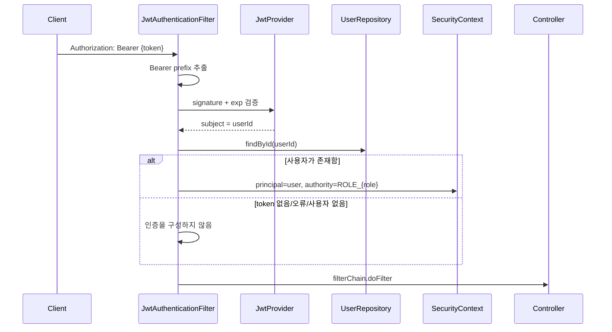
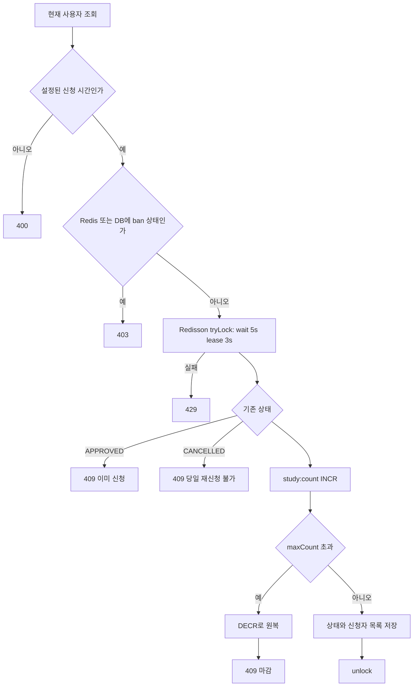
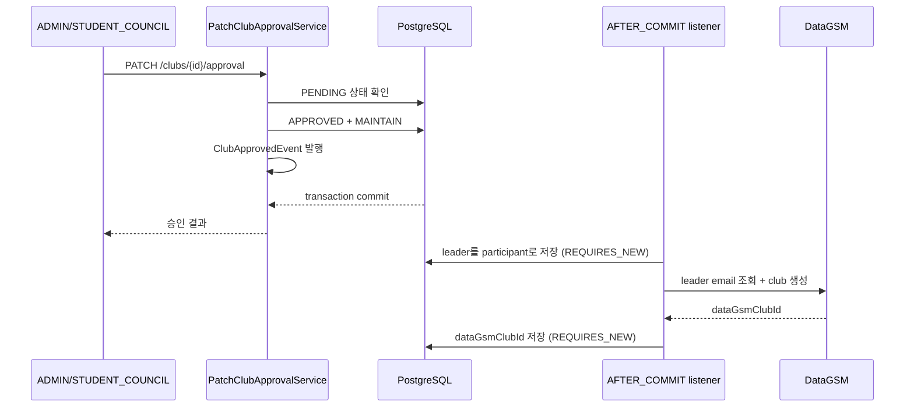
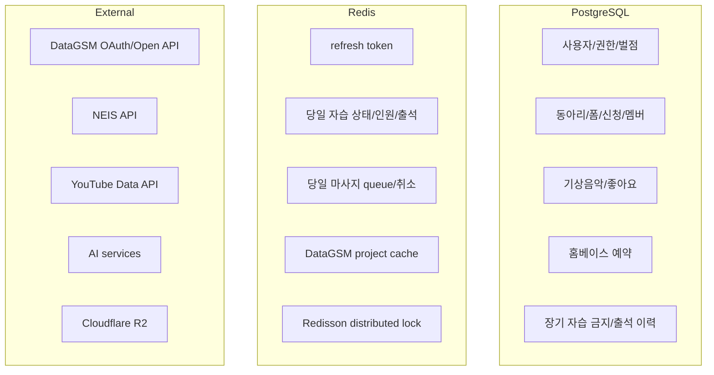

# 요청 처리 흐름 상세 분석

기준 커밋: [`53a3c80e4e0c0d36e4cf84e97047fd5676628376`](https://github.com/team-incube/Flooding-Server-V2/tree/53a3c80e4e0c0d36e4cf84e97047fd5676628376)

## 1. 프로젝트 구조와 계층 경계

```text
team.incube.flooding
├─ domain
│  ├─ auth / user / club / homebase / neis / ai
│  └─ dormitory
│     ├─ study / music / massage / penalty / cleaningzone
└─ global
   ├─ auth / security / config / client
   ├─ scheduler / sse / util / exception
   └─ ...
```

도메인 내부는 대체로 아래 역할을 반복합니다.

| 계층 | 책임 |
| --- | --- |
| `presentation/controller` | URL mapping, request binding, Bean Validation, HTTP response 선택 |
| `presentation/data`, `dto` | request/response payload |
| `service` | interface와 use-case 단위 계약 |
| `service/impl` | 상태·권한 검증, transaction, 여러 저장소/외부 연동 조합 |
| `repository` | Spring Data JPA query와 영속성 접근 |
| `entity` | JPA entity, enum, 복합키 |
| `adapter` | Redis, SSE, AI 같은 비-JPA 구현 세부사항 |
| `global` | security, 공용 client, object storage, scheduler, 공통 configuration |

Controller가 repository를 직접 호출하지 않고 use-case service를 통과하는 형태가 대부분이라 HTTP 계층과 업무 규칙의 경계가 비교적 분명합니다.

## 2. 모든 보호 API에 공통인 흐름

### 2.1 인증 정보 구성

관련 코드:

- [`SecurityConfig.kt`](https://github.com/team-incube/Flooding-Server-V2/blob/53a3c80e4e0c0d36e4cf84e97047fd5676628376/src/main/kotlin/team/incube/flooding/global/security/config/SecurityConfig.kt)
- [`JwtAuthenticationFilter.kt`](https://github.com/team-incube/Flooding-Server-V2/blob/53a3c80e4e0c0d36e4cf84e97047fd5676628376/src/main/kotlin/team/incube/flooding/global/security/filter/JwtAuthenticationFilter.kt)
- [`CurrentUserProvider.kt`](https://github.com/team-incube/Flooding-Server-V2/blob/53a3c80e4e0c0d36e4cf84e97047fd5676628376/src/main/kotlin/team/incube/flooding/global/security/util/CurrentUserProvider.kt)



JWT payload에는 사용자 ID만 subject로 저장됩니다. 실제 role은 매 요청 사용자 row에서 읽어 `ROLE_ADMIN` 같은 authority로 변환합니다. 토큰 발급 뒤 역할이 바뀌어도 새 토큰 없이 반영되는 대신, 인증된 요청마다 DB 조회가 필요합니다.

Security 설정은 session을 만들지 않는 stateless 방식이고 CSRF, form login, HTTP Basic은 비활성화돼 있습니다. 인증 실패는 `401`, 인증은 되었지만 역할이 부족하면 custom access-denied handler로 이어집니다.

SSE의 async/error/forward redispatch는 별도 permit 처리합니다. 비동기 재디스패치 시 비어 있는 thread-local security context 때문에 이미 시작된 event stream이 `403`으로 끊기는 상황을 막기 위한 구현입니다.

### 2.2 Controller와 응답

일반 흐름은 다음과 같습니다.

```text
HTTP request
  → Spring argument resolver / @Valid
  → Controller method
  → domain Service interface
  → ServiceImpl
  → CommonApiResponse.success/created
```

공통 응답·예외 wrapping은 `team.themoment` SDK에 맡깁니다. `application.yml`에서 Swagger, logging, response wrapping, exception 기능을 켜며 SSE와 Swagger path는 wrapping 대상에서 제외합니다.

## 3. 인증 흐름

### 3.1 로그인

관련 코드:

- [`AuthController.kt`](https://github.com/team-incube/Flooding-Server-V2/blob/53a3c80e4e0c0d36e4cf84e97047fd5676628376/src/main/kotlin/team/incube/flooding/domain/auth/controller/AuthController.kt)
- [`SignInService.kt`](https://github.com/team-incube/Flooding-Server-V2/blob/53a3c80e4e0c0d36e4cf84e97047fd5676628376/src/main/kotlin/team/incube/flooding/domain/auth/service/SignInService.kt)
- [`CreateUserService.kt`](https://github.com/team-incube/Flooding-Server-V2/blob/53a3c80e4e0c0d36e4cf84e97047fd5676628376/src/main/kotlin/team/incube/flooding/domain/user/service/CreateUserService.kt)

1. `POST /auth/signin`이 `authCode`, `redirectUri`를 받습니다.
2. DataGSM SDK로 authorization code를 OAuth access token으로 교환합니다.
3. 그 token으로 DataGSM 사용자 정보를 조회합니다.
4. 학생 계정이 아니면 `403`을 반환합니다.
5. DataGSM student ID를 PK로 사용자 row를 찾습니다.
6. 최초 사용자면 이름, 성별, 이메일, 학번, 역할, 기숙사 호실, 전공을 매핑해 생성합니다.
7. 같은 user ID를 subject로 하는 access/refresh JWT를 각각 만듭니다.
8. refresh token을 `refresh:token:{userId}`에 만료 시간과 함께 저장합니다.
9. 두 token을 응답합니다.

DataGSM 오류 status는 내부 HTTP status와 한글 메시지로 명시적으로 변환됩니다.

### 3.2 재발급

관련 코드: [`ReissueTokenService.kt`](https://github.com/team-incube/Flooding-Server-V2/blob/53a3c80e4e0c0d36e4cf84e97047fd5676628376/src/main/kotlin/team/incube/flooding/domain/auth/service/ReissueTokenService.kt)

```text
refresh JWT parse
→ userId 추출 실패면 401
→ Redis의 refresh token 조회
→ 요청 token과 문자열 비교
→ 불일치면 Redis 값 삭제 + 401
→ 새 access/refresh 생성
→ Redis refresh token 덮어쓰기
→ 새 token pair 반환
```

rotation 방식이라 한 번 사용한 refresh token은 새 token 저장 직후 재사용할 수 없습니다.

## 4. Redis와 분산 락: 자습 신청

관련 코드:

- [`StudyApplicationServiceImpl.kt`](https://github.com/team-incube/Flooding-Server-V2/blob/53a3c80e4e0c0d36e4cf84e97047fd5676628376/src/main/kotlin/team/incube/flooding/domain/dormitory/study/service/impl/StudyApplicationServiceImpl.kt)
- [`StudyRedisAdapter.kt`](https://github.com/team-incube/Flooding-Server-V2/blob/53a3c80e4e0c0d36e4cf84e97047fd5676628376/src/main/kotlin/team/incube/flooding/domain/dormitory/study/adapter/StudyRedisAdapter.kt)
- [`StudyResetScheduler.kt`](https://github.com/team-incube/Flooding-Server-V2/blob/53a3c80e4e0c0d36e4cf84e97047fd5676628376/src/main/kotlin/team/incube/flooding/global/scheduler/StudyResetScheduler.kt)

### 4.1 사용하는 key

| Key | 자료 구조 | 의미 | 수명 |
| --- | --- | --- | --- |
| `study:application:{userId}` | String | `APPROVED`, `CANCELLED`, `BANNED` | 다음 06:00까지 |
| `study:count` | String/number | 승인된 현재 인원 | 다음 06:00까지 |
| `study:applicants` | List | 신청 순서의 user ID | 다음 06:00까지 |
| `study:attendance` | Set | 출석 완료 user ID | 다음 06:00까지 |

### 4.2 신청 순서



오전 6시 경계를 하루 상태의 종료 시점으로 삼습니다. TTL 외에 스케줄러가 매일 06:00에 application key를 scan하고 count/list/set을 삭제합니다.

자습 금지는 Redis의 당일 상태뿐 아니라 PostgreSQL의 `StudyBanJpaEntity`와 `bannedUntil`도 함께 확인하므로 서버 재시작과 날짜 경계를 넘어 유지됩니다.

### 4.3 출석 SSE

관리자가 출석을 check/uncheck하면 Redis Set을 갱신하고 출석 SSE registry에 이벤트를 방송합니다. 구독 시점에는 현재 checked ID 목록을 `init`으로 보내고 이후 변경분을 event로 전송합니다.

## 5. Redis 대기열: 마사지 신청

마사지도 Redisson 락으로 정원 경쟁을 직렬화합니다. 차이는 Redis List를 대기열로 사용하고 자정까지 상태를 유지한다는 점입니다.

```text
신청 시간 확인
→ massage 전용 분산 락
→ 이미 신청했는지 확인
→ 당일 취소로 재신청이 차단됐는지 확인
→ 현재 queue size와 maxCount 비교
→ userId를 queue 뒤에 추가
```

취소하면 queue에서 제거하고 별도의 cancelled key를 자정까지 저장하여 같은 날 다시 신청하지 못하게 합니다.

## 6. PostgreSQL transaction + SSE: 기상음악

관련 코드:

- [`ApplyWakeUpMusicServiceImpl.kt`](https://github.com/team-incube/Flooding-Server-V2/blob/53a3c80e4e0c0d36e4cf84e97047fd5676628376/src/main/kotlin/team/incube/flooding/domain/dormitory/music/service/impl/ApplyWakeUpMusicServiceImpl.kt)
- [`YoutubeClient.kt`](https://github.com/team-incube/Flooding-Server-V2/blob/53a3c80e4e0c0d36e4cf84e97047fd5676628376/src/main/kotlin/team/incube/flooding/global/client/YoutubeClient.kt)
- [`WakeUpMusicSseEmitterRegistry.kt`](https://github.com/team-incube/Flooding-Server-V2/blob/53a3c80e4e0c0d36e4cf84e97047fd5676628376/src/main/kotlin/team/incube/flooding/domain/dormitory/music/adapter/WakeUpMusicSseEmitterRegistry.kt)

### 6.1 신청

1. 현재 사용자의 오늘 신청이 이미 있는지 DB에서 확인합니다.
2. `youtube.com`, `youtu.be`, embed URL에서 video ID를 추출합니다.
3. YouTube Data API의 `videos?part=snippet,contentDetails`를 호출합니다.
4. title, channel title, ISO-8601 duration, thumbnail, canonical watch URL을 정규화합니다.
5. 기상음악 entity를 `saveAndFlush`합니다. 동시 중복은 DB constraint exception도 `409`로 변환합니다.
6. 응답 DTO를 만듭니다.
7. transaction synchronization의 `afterCommit`에서 `music-applied` SSE를 방송합니다.

### 6.2 목록과 좋아요

목록 query는 음악과 like count를 한 번에 가져오고, 현재 사용자가 누른 like ID를 별도로 한 번 조회합니다. 이후 memory에서 `TIME` 또는 `LIKE` 기준으로 정렬합니다. like 생성/취소도 commit 이후 `music-like-updated`를 방송합니다.

### 6.3 SSE 생명주기

| 항목 | 구현 |
| --- | --- |
| emitter timeout | 1,800,000 ms (30분) |
| 연결 직후 | `connect`, `init` event |
| 변경 event | `music-applied`, `music-cancelled`, `music-like-updated` |
| heartbeat | 30초마다 comment event |
| 느린 client | 전송 3초 timeout 뒤 registry에서 제거 |
| registry | `CopyOnWriteArrayList<SseEmitter>` in-memory |

각 emitter 전송은 별도 executor의 `CompletableFuture`로 실행되어 한 느린 연결이 전체 방송 loop를 막지 않게 합니다.

## 7. 동아리 기능

### 7.1 개설과 승인

동아리 개설은 현재 사용자를 leader로 둔 `ClubJpaEntity`를 저장하며 approval status 기본값은 `PENDING`입니다.



Listener가 `@Async` + `AFTER_COMMIT`이므로 내부 승인 transaction은 외부 API 성공 여부와 분리됩니다. DataGSM 생성 실패 시 내부 승인은 유지됩니다.

### 7.2 전공 동아리 폼 신청

폼 생성 시 기존 active form을 모두 비활성화하고 새 form, field, option을 저장합니다. 제출 시:

1. active form과 `MAJOR_CLUB`인지 확인
2. 이미 참가자이거나 기존 submission이 있는지 확인
3. request answer를 `fieldId` 기준 map으로 구성
4. 필수 field의 blank answer를 모아 한 번에 `400` 처리
5. submission 저장
6. form의 모든 field에 대해 answer row 저장; 미제출 선택 field는 `null`

리더가 신청자를 승인하면 참가자 row를 생성한 뒤 해당 submission의 answer와 submission을 삭제합니다.

### 7.3 자율 동아리 선착순 신청

동아리별 `autonomous-club-application:{clubId}` 분산 락을 사용합니다. 락 내부에서 별도 `TransactionTemplate`을 열고 유형, 정원, 기존 참가·신청 여부를 확인한 뒤 application과 participant를 함께 저장합니다. 동아리마다 lock key가 달라 서로 다른 동아리 신청은 병렬 처리됩니다.

### 7.4 상세 조회와 DataGSM 프로젝트 cache

상세 조회는 내부 leader/participant를 합쳐 중복 제거하고, `dataGsmClubId`가 있으면 프로젝트 목록을 Redis에서 찾습니다. cache miss이면 DataGSM open API를 호출해 저장합니다.

서버 기동 직후 virtual thread가 연결된 모든 동아리 cache를 warm-up하고, 이후 30분마다 다시 갱신합니다. 외부 호출 실패 시 기존 cache를 지우지 않습니다.

## 8. 외부 AI 서버 호출

관련 코드:

- [`AiChatbotAdapter.kt`](https://github.com/team-incube/Flooding-Server-V2/blob/53a3c80e4e0c0d36e4cf84e97047fd5676628376/src/main/kotlin/team/incube/flooding/domain/ai/adapter/AiChatbotAdapter.kt)
- [`AiSongAdapter.kt`](https://github.com/team-incube/Flooding-Server-V2/blob/53a3c80e4e0c0d36e4cf84e97047fd5676628376/src/main/kotlin/team/incube/flooding/domain/ai/adapter/AiSongAdapter.kt)
- [`AiResilienceConfig.kt`](https://github.com/team-incube/Flooding-Server-V2/blob/53a3c80e4e0c0d36e4cf84e97047fd5676628376/src/main/kotlin/team/incube/flooding/global/config/AiResilienceConfig.kt)

| 정책 | 챗봇 | 음악 추천 |
| --- | --- | --- |
| connect timeout | 3초 | 3초 |
| read timeout | 10초 | 30초 |
| retry | 최대 3회, 1초 간격 | 최대 2회, 2초 간격 |
| 재시도 대상 | `ResourceAccessException` | `ResourceAccessException` |
| slow call 기준 | 8초 | 25초 |
| circuit open 조건 | 최소 5회 후 실패율 50% 또는 slow 비율 80% | 동일 |
| open 유지 | 30초 | 30초 |
| half-open probe | 3회 | 3회 |

HTTP error response는 재시도 대상이 아니라 즉시 내부 `502`로 변환됩니다. circuit이 open이면 `503`, 연결/기타 실패는 `502`입니다.

## 9. 홈베이스 예약

예약 생성 transaction 안에서 다음 순서로 검증합니다.

1. homebase 존재 여부
2. 요청 인원이 homebase capacity 이하인지
3. 같은 homebase·날짜에 요청 교시 범위와 겹치는 예약이 있는지
4. 요청 학생 중 같은 날짜·교시에 다른 홈베이스 예약과 겹치는 학생이 있는지
5. reservation 저장
6. reservation-member 관계 일괄 저장

공간 중복과 학생 중복을 별도로 검사하는 점이 핵심입니다.

## 10. 파일 업로드와 R2

관련 코드: [`FileStorageService.kt`](https://github.com/team-incube/Flooding-Server-V2/blob/53a3c80e4e0c0d36e4cf84e97047fd5676628376/src/main/kotlin/team/incube/flooding/global/util/FileStorageService.kt)

```text
빈 파일 검사
→ 확장자 jpg/jpeg/png/webp allow-list
→ MIME type image/jpeg,image/png,image/webp allow-list
→ 파일 앞 12 byte로 JPEG/PNG/WebP signature 확인
→ sub-directory traversal 검사
→ UUID 기반 object key 생성
→ S3-compatible client로 R2 putObject
→ public base URL 반환
```

저장 객체에는 `public, max-age=31536000, immutable` cache-control을 설정합니다. 파일명이 UUID이므로 내용이 바뀌면 URL도 바뀐다는 전제와 잘 맞습니다.

## 11. 저장소별 책임 정리



## 12. 코드 독해 결론

이 서버의 핵심 설계는 다음 세 문장으로 요약할 수 있습니다.

1. **지속해야 하는 업무 데이터는 JPA transaction으로, 하루 단위 경쟁 상태는 Redis와 분산 락으로 처리한다.**
2. **사용자 요청은 얇은 Controller와 use-case Service를 통과시키고 권한·상태 검증을 Service에서도 보강한다.**
3. **외부 서비스와 실시간 알림은 cache, retry/circuit breaker, after-commit event를 사용해 핵심 DB transaction과 가능한 한 분리한다.**

따라서 이 프로젝트를 이해할 때 entity 관계만 보는 것보다, 각 기능이 PostgreSQL·Redis·외부 API 중 어디에 상태를 두며 어느 지점에서 transaction 또는 lock 경계를 잡는지를 따라가는 것이 가장 중요합니다.
